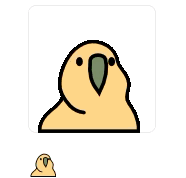

# slack-big-emoji

**한국어** | [English](README.en.md)

Slack 이모지를 큰 이미지로, 내 이름으로 올립니다.

```
/big :party_parrot:
```



*위: `/big`으로 올린 것. 아래: 같은 이모지를 일반 메시지로 보낸 것.*

Slack은 메시지에 이모지만 있어도 이모지를 작게 보여 줍니다. `/big`은 이모지의 원본 이미지를 대신 올려서 원래 크기로 보여 줍니다(커스텀 이모지는 최대 128px, 기본 이모지는 160px). 메시지는 봇이 아니라 내 계정으로 올라가고, 움직이는 이모지는 움직이는 채로 올라갑니다.

직접 호스팅하는 앱입니다. 공개 설치 링크는 없습니다. Slack 앱을 직접 만들고, 이 작은 Node 서버를 워크스페이스용으로 실행해야 합니다.

## 사용법

```
/big :party_parrot:
/big party_parrot
/big :thumbsup::skin-tone-3:
```

- 두 형태 모두 됩니다. 이름은 대소문자를 가리지 않고, 별칭(alias)은 원본 이모지로 바꿔서 찾습니다.
- `:smile:` 같은 기본 이모지도 되고, 피부색도 반영합니다. 기본 이모지는 Apple 160px 이미지로 올라갑니다.
- 처음 쓸 때는 나에게만 보이는 **Connect Slack account** 버튼이 나옵니다. 브라우저에서 한 번 허용하면 이모지가 바로 올라갑니다. 그 뒤로는 `/big`만 입력하면 됩니다.
- 오류(없는 이모지, 이모지를 두 개 이상 입력한 경우)는 나에게만 보입니다.

제한 사항:

- 명령어 한 번에 이모지 하나만 올립니다.
- Slack은 스레드 안에서 슬래시 커맨드를 허용하지 않습니다.
- 이미지를 키우지는 않습니다. 64px 이모지는 64px로 보입니다.
- 기본 이모지 이미지는 Slack이 아니라 jsDelivr([emoji-data](https://github.com/iamcal/emoji-data) 저장소)에서 불러옵니다. 이 CDN에 장애가 나면 기본 이모지만 올라가지 않습니다.

## 동작 방식

1. Slack이 Socket Mode로 `/big`을 앱에 전달합니다.
2. 앱이 봇 토큰으로 `emoji.list`를 호출해 이모지의 이미지 URL을 찾습니다. 목록은 10분 동안 캐시합니다. 캐시에 없는 이름이 들어오면 목록을 미리 새로 받아 오는데, 30초에 한 번까지만 합니다. 그래서 새로 추가한 이모지도 거의 바로 쓸 수 있습니다. 커스텀 이모지에 없는 이름은 함께 설치되는 `emoji-datasource`의 기본 이모지 목록에서 찾아 jsDelivr 이미지 URL을 만듭니다.
3. 앱이 내 사용자 토큰으로, 그 URL을 가리키는 이미지 블록 메시지를 올립니다. 이미지를 내려받거나 다시 업로드하지 않습니다.

사용자 토큰이 아직 없으면 3단계 대신 연결 버튼을 보냅니다. 버튼은 Slack의 OAuth 페이지를 열고, 콜백에서 토큰을 저장한 뒤 요청했던 이모지를 올립니다. 버튼은 `STATE_SECRET`으로 서명되고 10분 동안만 쓸 수 있으며, 다른 계정으로 허용하면 거절됩니다. 나중에 앱 연결을 해제하면 다음 `/big` 때 버튼이 다시 나옵니다.

## 권한

| 토큰 | 권한 | 쓰는 곳 |
| --- | --- | --- |
| 봇 | `commands` | 슬래시 커맨드 받기 |
| 봇 | `emoji:read` | 워크스페이스의 커스텀 이모지 목록 조회 |
| 사용자 | `chat:write` | 이모지를 내 이름으로 올리기 |

앱은 사용자 토큰을 요청한 이모지를 올리는 데만 씁니다. 메시지를 읽는 권한은 요청하지 않습니다.

## 설치

Node 22 이상과, 앱의 포트로 연결되는 공개 HTTPS 주소가 필요합니다. Cloudflare Tunnel이나 Tailscale Funnel을 쓰면 됩니다. 앱은 Socket Mode를 쓰므로 외부에 열리는 경로는 OAuth 콜백 `/slack/oauth/callback` 하나뿐입니다.

1. https://api.slack.com/apps 에서 **From a manifest**로 앱을 만들고 `manifest.yml`을 붙여 넣습니다. `redirect_urls`는 `https://<내 호스트>/slack/oauth/callback`으로 바꿉니다.
2. **Basic Information → App-Level Tokens**: `connections:write` 권한으로 토큰을 만듭니다 → `SLACK_APP_TOKEN`.
3. 앱을 워크스페이스에 설치합니다. **OAuth & Permissions → Bot User OAuth Token** → `SLACK_BOT_TOKEN`.
4. **Basic Information → App Credentials**: Client ID와 Client Secret → `SLACK_CLIENT_ID`, `SLACK_CLIENT_SECRET`.
5. `.env`를 채우고 실행합니다.

```sh
cp .env.example .env
npm install
npm start
```

로그에 `/big ready. OAuth callback: https://…`가 나오면 준비된 것입니다. `OAuth disabled`가 나오면 `SLACK_CLIENT_ID`, `SLACK_CLIENT_SECRET`, `STATE_SECRET`, `PUBLIC_URL` 중 빈 값이 있는 것이고, 새 사용자가 연결할 수 없습니다.

배포 하나는 워크스페이스 하나만 담당합니다.

## 환경 변수

| 변수 | 필수 | 설명 |
| --- | --- | --- |
| `SLACK_BOT_TOKEN` | 예 | 봇 토큰 (`xoxb-…`) |
| `SLACK_APP_TOKEN` | 예 | Socket Mode용 앱 레벨 토큰 (`xapp-…`) |
| `SLACK_CLIENT_ID`, `SLACK_CLIENT_SECRET` | 연결용 | Slack 앱의 OAuth 자격 증명 |
| `STATE_SECRET` | 연결용 | 연결 버튼을 서명하는 비밀값. `openssl rand -hex 32`로 만듭니다. |
| `PUBLIC_URL` | 연결용 | 콜백이 열리는 HTTPS 주소. 예: `https://big-emoji.example.com` |
| `PORT` | 아니요 | 콜백 서버 포트. 기본값 `3000`. |
| `SLASH_COMMAND` | 아니요 | 커맨드 이름. 기본값 `/big`. Slack 앱에 등록한 커맨드와 같아야 합니다. |
| `TOKEN_FILE` | 아니요 | 사용자 토큰을 저장하는 위치. 앱을 실행한 디렉터리 기준입니다. 기본값 `data/tokens.json`. |
| `LOG_LEVEL` | 아니요 | Bolt 로그 레벨. `debug`, `info`, `warn`, `error` 중 하나. 기본값 `info`. |

필수가 아닌 변수는 비워 두면 기본값을 씁니다.

## 토큰 파일

토큰 파일(`data/tokens.json`, 또는 `TOKEN_FILE`로 지정한 경로)에는 사용자 토큰이 일반 JSON으로 들어 있습니다(파일 권한 `600`). 이 파일을 가진 사람은 그 사용자들의 이름으로 메시지를 올릴 수 있습니다.

- git에 올리지 말고, 남과 공유하는 백업에도 넣지 마세요. `.gitignore`는 `data/`만 제외하므로, 경로를 바꿨다면 그 파일과 옆에 생기는 `.tmp` 파일을 직접 제외 목록에 추가해야 합니다.
- 배포할 때 덮어쓰지 마세요.
- 서버를 옮길 때는 앱과 함께 옮기세요. 옮기지 않으면 모든 사용자가 다시 연결해야 합니다.

## 테스트

```sh
npm test
```

## 라이선스

MIT
